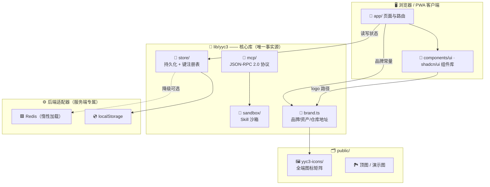

<div align="center">


# 言语云³集成中心系统

**YYC³ Intelligent Hub System**

发现、连接并管理强大的集成应用 —— 面向多端的一致化智能集成中枢

[](https://github.com/YYC-Cube/YYC3-Intelligent-Hub-System/actions/workflows/ci-cd.yml)
[](LICENSE)
[](https://nexus.yyc3.vip)

[](https://nextjs.org)
[](https://react.dev)
[](https://www.typescriptlang.org)
[](https://tailwindcss.com)

[](https://github.com/YYC-Cube/YYC3-Intelligent-Hub-System/stargazers)
[](https://github.com/YYC-Cube/YYC3-Intelligent-Hub-System/network/members)
[](https://github.com/YYC-Cube/YYC3-Intelligent-Hub-System/commits)
[](CONTRIBUTING.md)

**[🚀 快速开始](#-快速开始)** · **[🏗️ 系统架构](#️-系统架构)** · **[🎨 图标资产体系](#-品牌与图标资产体系全端接入)** · **[🤝 参与贡献](#-参与贡献)**

</div>

---

## 📖 项目简介

言语云³集成中心系统（YYC³-IC）是一个**静态导出、多端适配**的集成应用市场与智能中枢：

- 🛒 **集成市场** —— 分类浏览、搜索、详情、安装向导
- 🤖 **AI 智能** —— 用户行为分析、增强推荐、集成式助手
- 🔐 **安全内建** —— 客户端加密上下文、Skill 沙箱、凭据服务端隔离
- 📱 **PWA 就绪** —— 可安装、离线壳、iOS / Android 全端图标
- ⚡ **静态部署** —— `next build` 产出纯静态站点，GitHub Pages 自动发布

> 🌐 在线演示：**<https://nexus.yyc3.vip>**

---

## 🏗️ 系统架构



### 核心分层职责

| 模块 | 职责 | 关键约束 |
|:---|:---|:---|
| 🎨 `lib/yyc3/brand.ts` | 品牌文案、图标路径、仓库地址唯一事实源 | 页面**禁止**硬编码资产路径 |
| 💾 `lib/yyc3/store/` | 持久化抽象 + 键注册表 + 幽灵键拦截 | 客户端/服务端出口分离 |
| 🔌 `lib/yyc3/mcp/` | MCP 协议（JSON-RPC 2.0）客户端与传输 | stdio / 内存回环双传输 |
| 🧺 `lib/yyc3/sandbox/` | Skill 执行沙箱 | 进程隔离 + 环境净化 + 限额 |
| 🧩 `components/ui/` | shadcn/ui 基础组件 + 全局导航/页脚 | 单一 navbar/footer 出口 |
| 📄 `app/` | App Router 页面、上下文与服务 | 静态导出（`output: 'export'`） |

### 目录速览

```text
├── app/                      # 📄 页面路由（marketplace、account、developer…）
│   ├── components/ui/        # 🧩 应用层组件（logo、loading-screen…）
│   └── services/ai/          # 🤖 AI 分析存活副本（含测试）
├── components/ui/            # 🧱 shadcn/ui 组件库
├── lib/yyc3/                 # 🔑 核心库（brand / store / mcp / sandbox）
├── public/
│   ├── yyc3-icons/           # 🖼️ 全端图标矩阵（见下节）
│   └── CNAME                 # 🌐 nexus.yyc3.vip
├── docs/                     # 📚 团队规范与历史报告（文档闭环）
├── __tests__/                # 🧪 Jest 组件测试
└── tests/                    # 🧪 Vitest 业务测试
```

---

## 🎨 品牌与图标资产体系（全端接入）

所有图标以 `public/yyc3-icons/ios/icon-1024.png`（1024×1024）为**母版**派生，按端分区：

| 🖼️ 分区 | 📁 目录 | 📐 尺寸 | 🎯 消费端 |
|:---|:---|:---|:---|
| 🌐 Favicon | `yyc3-icons/favicon/` | 16 / 32 / 48 / 96 | 浏览器标签页、收藏夹 |
| 📱 PWA | `yyc3-icons/pwa/` | 72 – 512 | `public/manifest.json` |
| ⚡ WebP 优化 | `yyc3-icons/webp/` | 192 / 512 | 现代浏览器优先加载 |
| 🍎 iOS | `yyc3-icons/ios/` | 20 – 1024 全梯度 | Safari 主屏图标 / Xcode / Capacitor |
| 🤖 Android | `yyc3-icons/android/mipmap-*` | mdpi – xxxhdpi | Gradle / 应用商店 |
| 📌 根级约定 | `public/favicon.ico`、`public/apple-touch-icon.png` | 48 / 180 | 系统**自动探测**固定路径 |

**引用规范：**

```ts
// ✅ 正确：从唯一事实源取路径
import { brandAssets } from "@/lib/yyc3/brand"
<Image src={brandAssets.logoPng} alt="言语云³" />

// ❌ 错误：硬编码字符串（历史上正是它导致全端 logo 断链）
<Image src="/images/logo.png" />
```

> 🔄 **更换品牌视觉**：只需替换 `public/yyc3-icons/` 整套文件，代码零改动。

---

## 💻 技术栈

| 层 | 技术 | 徽章 |
|:---|:---|:---|
| 框架 | Next.js 14（App Router · 静态导出） |  |
| UI | React 18 · shadcn/ui · Tailwind CSS 3 · framer-motion |  |
| 语言 | TypeScript 5（严格模式） |  |
| 协议 | MCP（JSON-RPC 2.0）· 自研传输层 |  |
| 测试 | Jest（组件）+ Vitest（业务） |  |
| 工程化 | ESLint 9 · Prettier · pnpm · GitHub Actions |  |

---

## 🚀 快速开始

```bash
# 克隆
git clone https://github.com/YYC-Cube/YYC3-Intelligent-Hub-System.git
cd YYC3-Intelligent-Hub-System

# 安装依赖（Node ≥ 20 / pnpm ≥ 9）
pnpm install

# 启动开发服务器
pnpm dev            # → http://localhost:3000

# 本地验证生产构建（静态导出至 out/）
pnpm build
```

<details>
<summary>📦 全部脚本一览</summary>

| 脚本 | 作用 |
|:---|:---|
| `pnpm dev` | 开发服务器 |
| `pnpm dev-with-mock` | 开发服务器 + Mock API |
| `pnpm build` | 生产构建（静态导出） |
| `pnpm lint` / `lint:fix` | ESLint 检查 / 自动修复 |
| `pnpm format` / `format:check` | Prettier 格式化 / 校验 |
| `pnpm test` | Jest 组件测试（`__tests__/`） |
| `pnpm test:unit` | Vitest 业务测试（`tests/`） |
| `pnpm test:all` | 双运行器全量测试 |
| `pnpm db:test` / `db:init` / `db:status` | 数据库联调脚本 |

</details>

---

## 🧪 测试体系

采用**双运行器**策略，职责分离、互不重叠：

```text
__tests__/  ──▶  Jest     ──▶  组件级单元测试
tests/      ──▶  Vitest   ──▶  业务流程测试（vi.mock 等）
```

```bash
pnpm test:all   # 一键全量
```

---

## 📦 部署

- ⚙️ 推送 `main` 触发 [GitHub Actions](.github/workflows/ci-cd.yml)：构建静态站点 → 发布 GitHub Pages
- 🌐 自定义域名 `nexus.yyc3.vip`（`public/CNAME`）
- 📁 构建产物为纯静态文件（`out/`），可托管至任意静态主机

---

## 🤝 参与贡献

| 📜 治理文件 | 说明 |
|:---|:---|
| [CONTRIBUTING.md](CONTRIBUTING.md) | 贡献指南：环境、工作流、提交规范、PR 清单 |
| [CODE_OF_CONDUCT.md](CODE_OF_CONDUCT.md) | 行为准则（Contributor Covenant 2.1） |
| [SECURITY.md](SECURITY.md) | 安全政策与漏洞上报流程 |
| [LICENSE](LICENSE) | MIT 许可证 |
| `docs/YYC3-团队通用-标准规范/` | 团队开发标准与文档闭环规范 |

欢迎通过 [Issue](https://github.com/YYC-Cube/YYC3-Intelligent-Hub-System/issues) 反馈问题、通过 PR 贡献代码！

---

## 🗺️ 路线图

- [x] 🔧 全端图标体系统一（brand.ts 唯一事实源）
- [x] 🧪 双测试运行器接入 CI
- [ ] ⬆️ 框架大版本迁移：Next.js 16 + React 19 + Tailwind CSS 4
- [ ] 🧠 `AI高级功能/` 实验模块（时序预测 / 异常检测 / 本地 ML）转正评估
- [ ] 📲 Capacitor 原生壳接入（复用 `yyc3-icons/ios` 与 `android/` 资产）

---

## 📄 许可证

本项目基于 [MIT License](LICENSE) 开源。

<div align="center">

**⭐ 如果言语云³对你有帮助，欢迎 Star 让更多人看到**

`言语云³ · YYC³ Intelligent Hub System`

</div>
